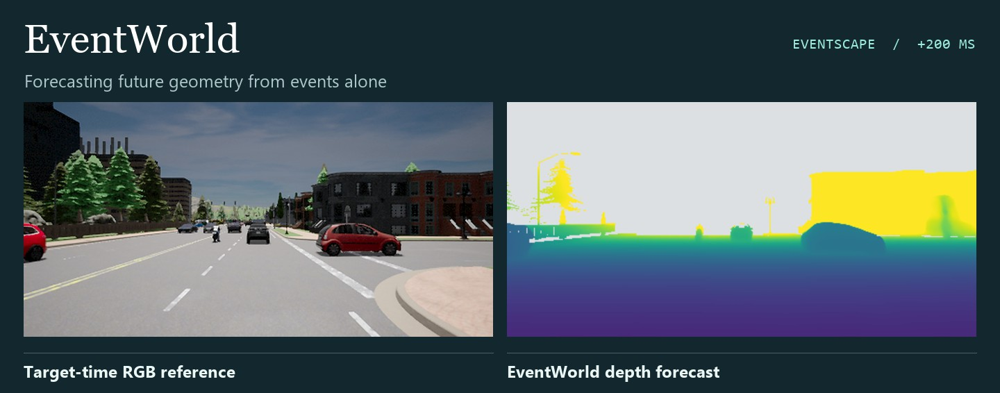
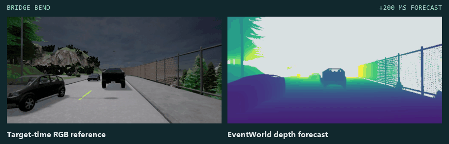
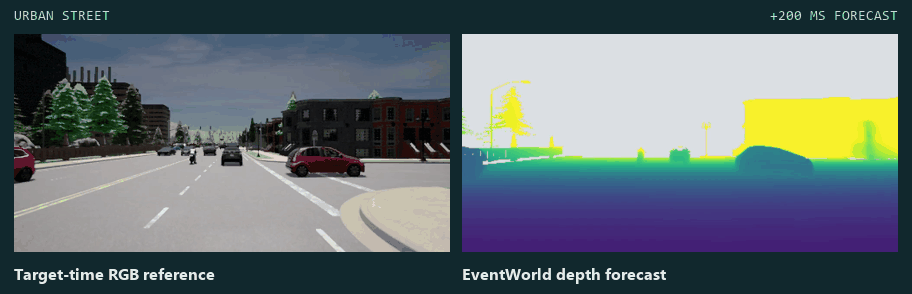
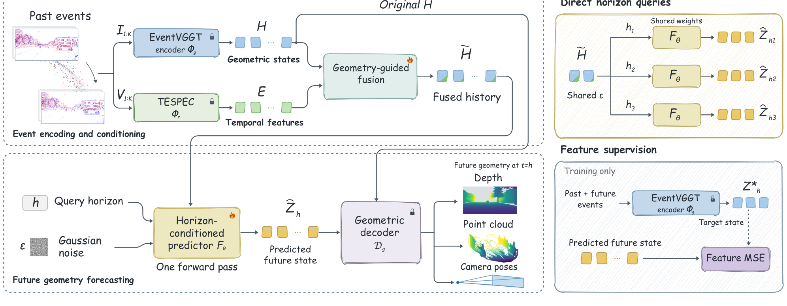
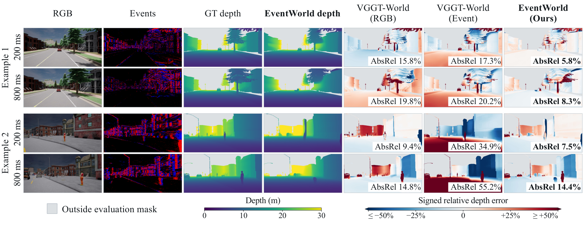
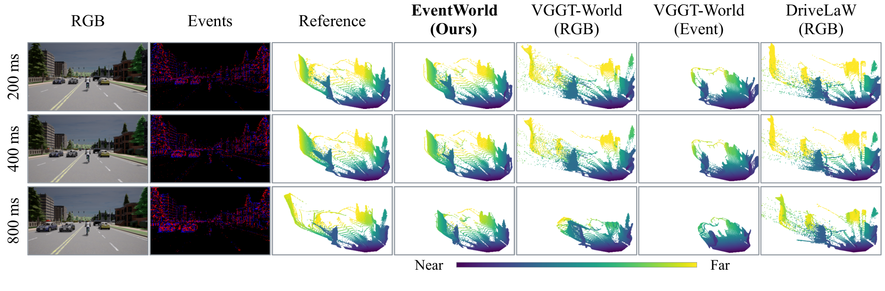
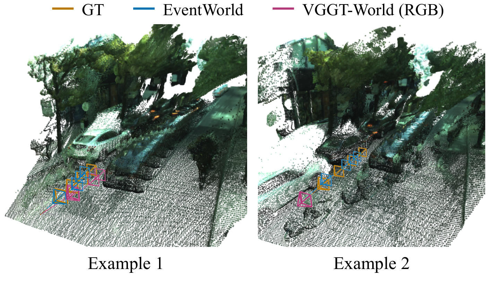
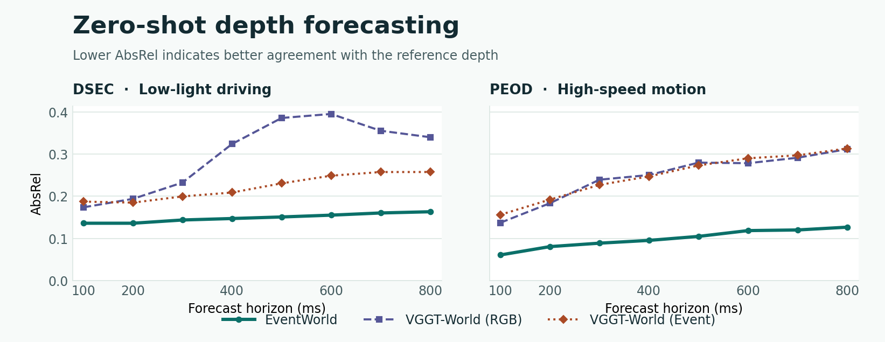
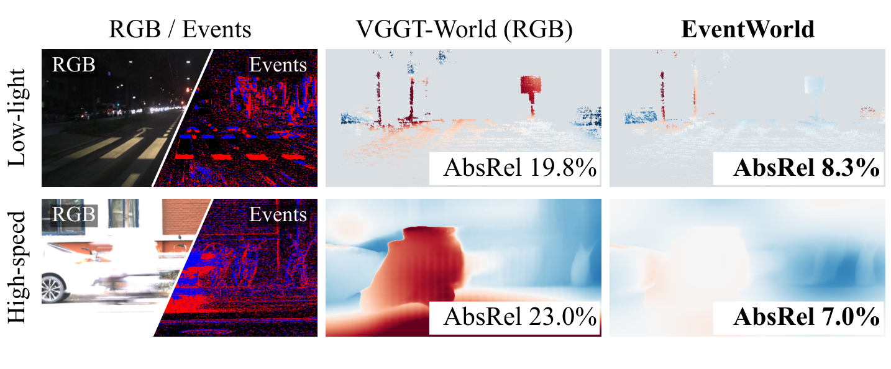
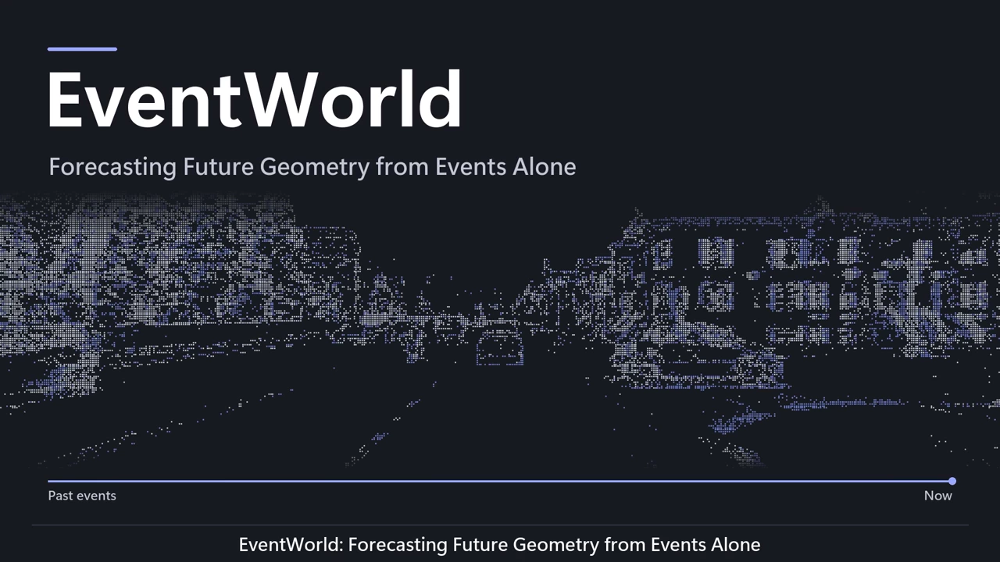

<h1 align="center">EventWorld</h1>

<strong>Forecasting Future Geometry from Events Alone</strong>

  <strong>Junhao Yan1, Dachun Kai2, Xiaoyan Sun2</strong> 
  1 Wuhan University of Technology 
  2 University of Science and Technology of China

  <a href="#driving-previews">Driving demos</a> &nbsp;·&nbsp;
  <a href="#method">Method</a> &nbsp;·&nbsp;
  <a href="#results">Results</a> &nbsp;·&nbsp;
  <a href="#run-eventworld">Run EventWorld</a> &nbsp;·&nbsp;
  <a href="#project-film">Film</a> &nbsp;·&nbsp;
  <a href="README.zh-CN.md">中文</a>

EventWorld turns **150 ms of camera events** into a forecast of **depth, point clouds, and camera poses** at a chosen future time. Its horizon-conditioned predictor generates the requested state in one forward pass.

| EventScape Town05 | DSEC low-light driving | Inference on NVIDIA A100 |
| :--- | :--- | :--- |
| **19.1%** lower mean AbsRel than DriveLaW (RGB) | **50.4%** lower mean AbsRel than VGGT-World (RGB) on one recording | **≈0.28 s** per query across 200–800 ms |

## Driving previews

The clips show a **+200 ms** depth forecast beside the RGB frame at that time. EventWorld uses events recorded before the observation cutoff.

Urban street sequence

## Method

Moving edges generate brightness changes that carry information about both geometry and motion. EventWorld combines the two signals to forecast a scene’s future state.

1. **Encode.** Frozen EventVGGT and TESPEC encoders extract geometry and motion features from three 50 ms event packets.
2. **Fuse and forecast.** Geometry guides the weighting of motion features at each patch. The fused history and the requested horizon condition a direct forecast.
3. **Decode.** A shared frozen decoder reads the forecast state alongside the original history to recover depth, point clouds, and camera poses.

Targets come from encoding events at the forecast time. This supervision lets the forecaster train without depth or pose annotations.

## Run EventWorld

Use Linux, Python 3.10, the PyTorch 2.3.1 CUDA 11.8 wheels, and one NVIDIA GPU with native BF16 support. Set up the pinned environment, download the two required checkpoints and the prepared test data, then run `python -m eventworld infer` for one window or `python -m eventworld test` to produce predictions and depth scores. The guide includes copy-paste commands, file paths, checksums, and reference scores. [Inference and testing guide](docs/REPRODUCING.md)

- Released model. [EventWorld P40530 weights](https://drive.google.com/file/d/1__Oy_SLwvmeaPiMeYueL2Ab7mz15f09L/view?usp=sharing) · [Required EventVGGT perception weights](https://huggingface.co/yinruiRen/EventVGGT/blob/main/checkpoint.pt) · [Optional EventVGGT pose weights](https://huggingface.co/yinruiRen/EventVGGT/blob/main/checkpoint_pose.pt)
- Prepared inputs and scoring labels. [EventScape test data](https://drive.google.com/file/d/159yCwVb9cn0hP5X1yp42RiW9bJhKVc7E/view?usp=sharing)
- Original dataset pages. [EventScape](https://rpg.ifi.uzh.ch/RAMNet.html) · [DSEC](https://dsec.ifi.uzh.ch/dsec-datasets/download/) · [PEOD](https://echosliu.github.io/PEOD-dataset/) · [M3ED](https://m3ed.io/sequences/)

## Results

### Depth forecasting on EventScape Town05

EventWorld achieves the lowest AbsRel at all four reported horizons. The margin over DriveLaW (RGB) widens from **0.0007** at 200 ms to **0.0376** at 800 ms. Mean δ₁ is **90.13%** for EventWorld and **90.17%** for DriveLaW.

| Method | Input | 200 ms | 400 ms | 600 ms | 800 ms | Mean AbsRel ↓ | Mean δ₁ ↑ |
| :--- | :--- | ---: | ---: | ---: | ---: | ---: | ---: |
| **EventWorld** | Events | **0.0789** | **0.0854** | **0.1003** | **0.1139** | **0.0946** | 90.13% |
| DriveLaW | RGB | 0.0796 | 0.1090 | 0.1280 | 0.1515 | 0.1170 | **90.17%** |
| VGGT-World | RGB | 0.0917 | 0.1131 | 0.1862 | 0.1645 | 0.1389 | 87.09% |
| Copy-last | Events | 0.1202 | 0.1616 | 0.1903 | 0.2122 | 0.1711 | 78.30% |

The four horizon columns report AbsRel on an EventScape Town05 evaluation subset, using non-sky reference depths within 30 m after per-prediction median scale alignment. [Full results (CSV)](results/eventscape-depth.csv)

### Point clouds and camera motion

| Task | Protocol | EventWorld | DriveLaW (RGB) |
| :--- | :--- | ---: | ---: |
| Point-cloud forecasting | Mean normalized Chamfer distance on EventScape, 200 and 800 ms ↓ | **0.0532** | 0.0590 |
| Point-cloud forecasting | Mean F-score at 1% of the reference cloud radius, 200 and 800 ms ↑ | **44.65%** | 40.55% |
| Camera-pose forecasting | Absolute trajectory error on M3ED, zero-shot, after per-window similarity alignment ↓ | **0.0973 m** | 0.1039 m |

EventScape point-cloud forecasts

M3ED camera-pose forecasts

### Transfer to real recordings

| Recording | Windows | Depth reference | Mean AbsRel reduction vs. VGGT-World (RGB) |
| :--- | ---: | :--- | ---: |
| DSEC low-light driving | 83 | Calibrated disparity, 30 m and common visibility | **50.4%** |
| PEOD high-speed motion | 73 | Target-time EventVGGT pseudo-depth | **59.8%** |

EventWorld transfers from EventScape without fine-tuning on these recordings. The reductions average eight forecast horizons from 100 to 800 ms. [Download the zero-shot depth table (CSV)](results/zero-shot-depth.csv)

### Scope

EventWorld returns a single prediction per horizon and can reuse the encoded history across queries. When both the camera and the scene are still, sparse events limit what it can observe.

## Project film

[Full film (.mp4)](media/eventworld-film.mp4) · [English captions (.vtt)](media/film.en.vtt) · [Interactive comparison](http://40.81.25.249/#driving)

## Acknowledgments

We thank the authors of VGGT-World and EventVGGT for releasing the pretrained models that EventWorld builds on.

- **VGGT-World.** Its KITTI checkpoint initializes EventWorld’s forecasting predictor. VGGT-World also serves as a forecasting baseline in our experiments. [Paper](https://arxiv.org/abs/2603.12655) · [Code](https://github.com/SimonSun0810/VGGT-World)
- **EventVGGT.** Its public perception weights provide the frozen geometry encoder, decoder, and depth head. Camera-pose forecasting uses the camera head from its official pose checkpoint. [Paper](https://arxiv.org/abs/2603.09385) · [Code](https://github.com/yinruiRen/EventVGGT)
