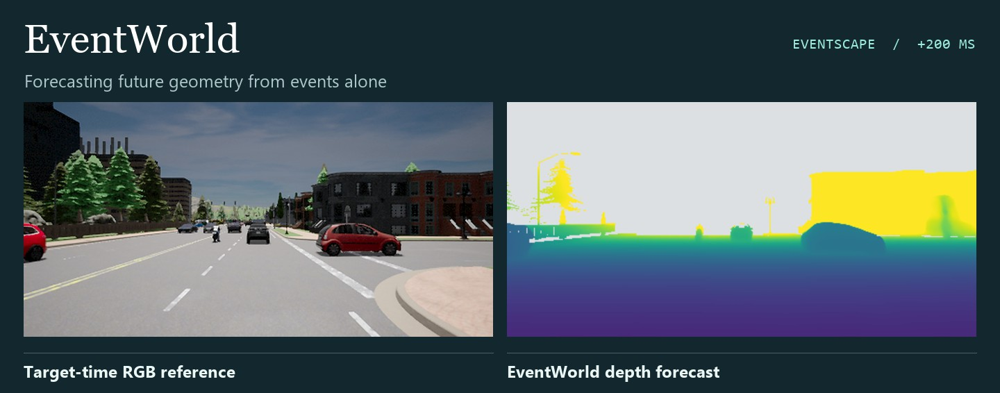
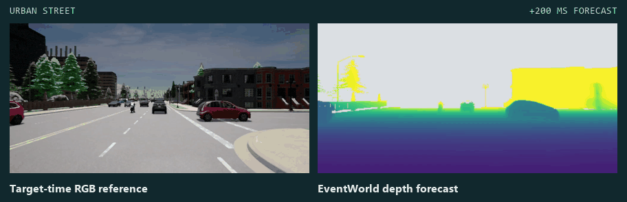
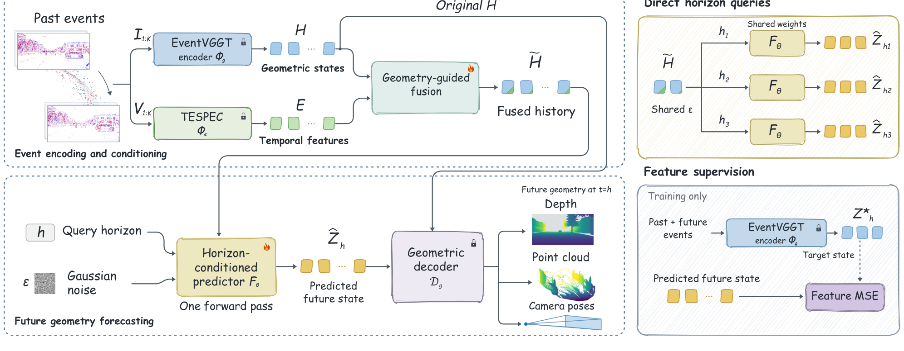
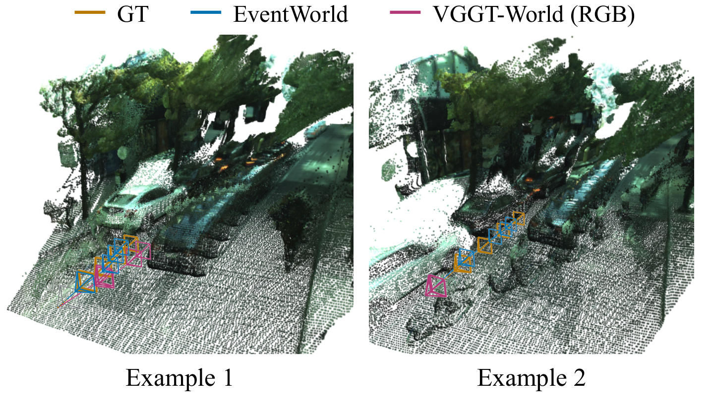
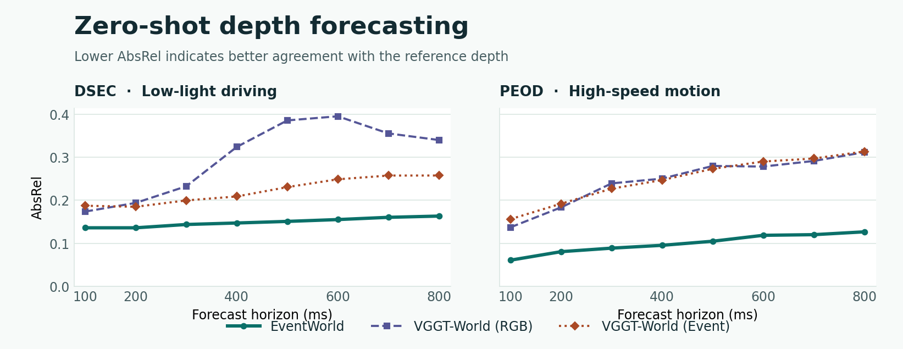
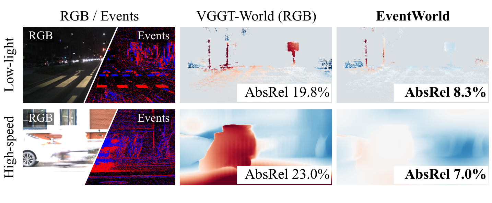
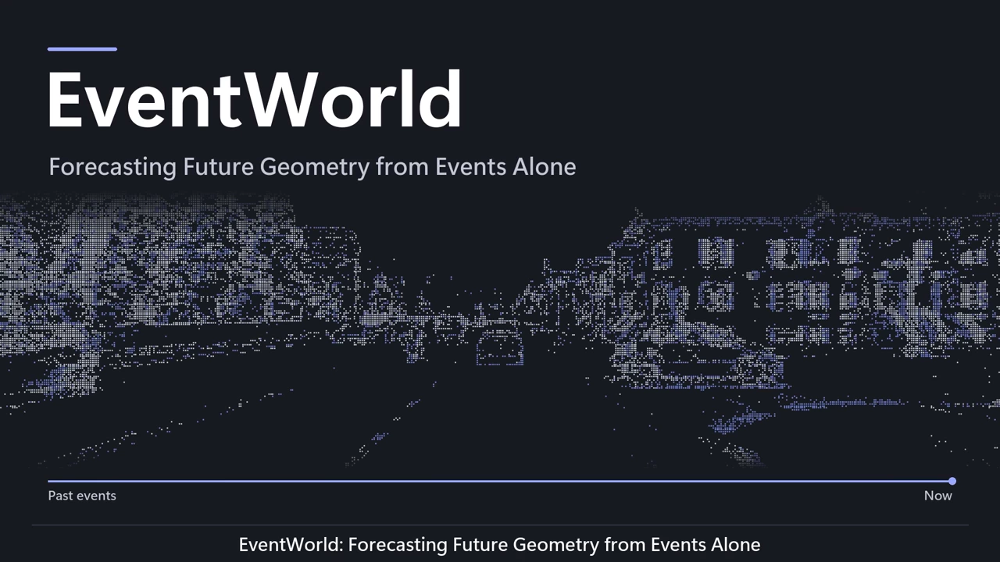

# EventWorld

**仅用相机事件预测未来场景几何**

EventWorld 读取过去 150 毫秒的相机事件，预测指定未来时刻的深度、点云和相机位姿。

**[驾驶演示](#驾驶演示)** · **[实验结果](#实验结果)** · **[英文介绍与完整结果](README.md)**

## 驾驶演示

左侧是目标时刻的 RGB 参考画面，右侧是提前 **200 毫秒**做出的深度预测。EventWorld 的输入只有观测截止前的事件。

桥上弯道序列

## 方法

EventVGGT 和 TESPEC 分别从三个 50 毫秒的事件包中提取几何状态和时序特征。模型用场景结构指导每个图像块融合哪些时序特征，再根据所选时距，用一次前向传播预测未来几何状态。共享解码器根据预测状态和历史状态恢复深度、点云和相机位姿。训练预测模块时，模型从未来事件构造监督目标，无需深度或位姿标注。

## 实验结果

- **EventScape Town05 深度。** 在训练未见的 Town05 上评测 238 个窗口。200、400、600、800 毫秒四个时距的平均 AbsRel 为 **0.0946**，相对 RGB 基线 DriveLaW 的 **0.1170** 降低 **19.1%**。平均 δ₁ 为 **90.13%**，DriveLaW 为 **90.17%**。评测对每个预测做中位数尺度对齐，使用 30 米内的非天空像素。[结果 CSV](results/eventscape-depth.csv)
- **EventScape 点云与 M3ED 位姿。** EventScape 在 200 和 800 毫秒的平均点云 F-score 为 **44.65%**，DriveLaW 为 **40.55%**，阈值为参考点云半径的 1%。M3ED 零样本评测中，经逐窗口相似变换对齐后的绝对轨迹误差为 **0.0973 米**，DriveLaW 为 **0.1039 米**。
- **真实低照与高速序列。** 直接将 EventScape 训练的模型用于一个 DSEC 低照录制和一个 PEOD 高速录制。在 100–800 毫秒的八个时距上，相比 VGGT-World（RGB）的平均 AbsRel 分别降低 **50.4%** 和 **59.8%**。DSEC 的参考深度由标定视差得到，PEOD 使用 EventVGGT 生成的伪深度。[结果 CSV](results/zero-shot-depth.csv)

点云和相机位姿预测

## 项目视频

[完整短片（MP4）](media/eventworld-film.mp4) · [英文字幕（VTT）](media/film.en.vtt) · [可逐帧拖动的交互对照](http://40.81.25.249/#driving)
