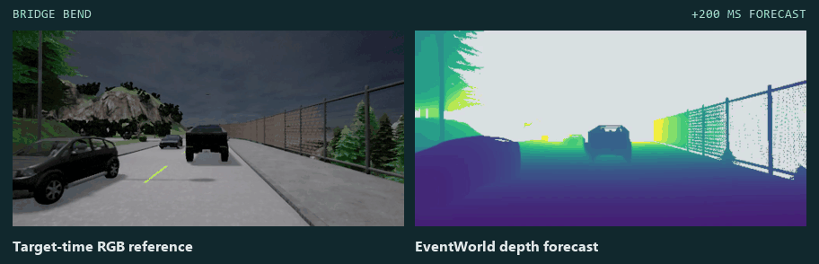
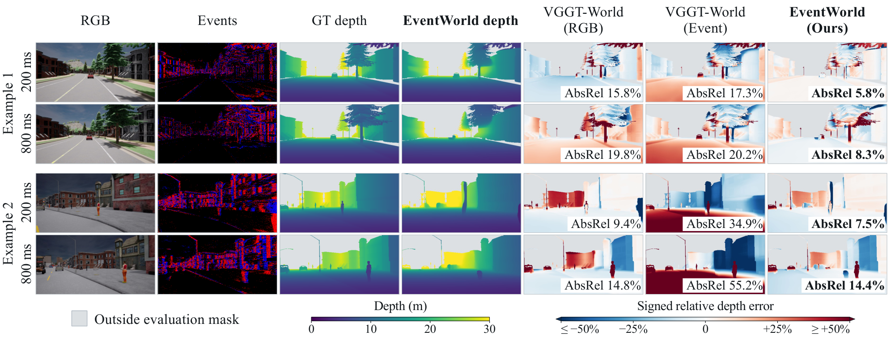
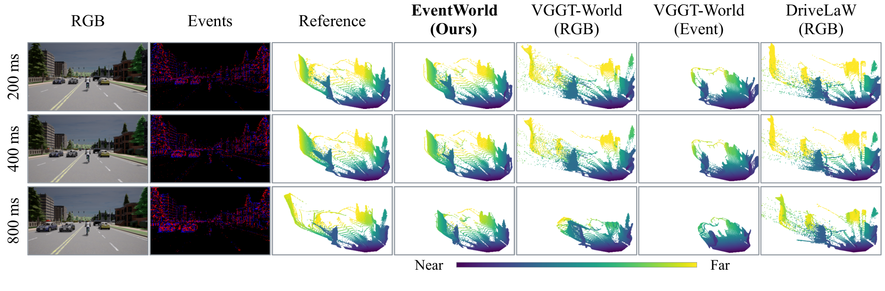

<h1 align="center">EventWorld</h1>

<strong>仅用相机事件预测未来场景几何</strong>

  <strong>Junhao Yan1, Dachun Kai2, Xiaoyan Sun2</strong> 
  1 武汉理工大学 
  2 中国科学技术大学

  <a href="#驾驶演示">驾驶演示</a> &nbsp;·&nbsp;
  <a href="#方法">方法</a> &nbsp;·&nbsp;
  <a href="#实验结果">实验结果</a> &nbsp;·&nbsp;
  <a href="docs/REPRODUCING.zh-CN.md">推理与测试</a> &nbsp;·&nbsp;
  <a href="#项目视频">项目短片</a> &nbsp;·&nbsp;
  <a href="README.md">English</a>

EventWorld 读取过去 **150 毫秒**的相机事件，用一次前向传播预测指定时刻的**深度、点云和相机位姿**。

| EventScape Town05 | DSEC 低照驾驶 | NVIDIA A100 推理 |
| :--- | :--- | :--- |
| 平均 AbsRel 比 DriveLaW（RGB）低 **19.1%** | 在一条低照录制上，平均 AbsRel 比 VGGT-World（RGB）低 **50.4%** | 200–800 毫秒时距的单次查询约 **0.28 秒** |

## 驾驶演示

左侧是目标时刻的 RGB 参考画面，右侧是提前 **200 毫秒**做出的深度预测。EventWorld 的输入只有观测截止前的事件。

城市街道序列

## 方法

1. **编码历史。** EventVGGT 和 TESPEC 分别从三个 50 毫秒事件包中提取场景结构和运动特征。
2. **融合与预测。** 每个图像块的几何状态用于给运动特征分配权重。预测器根据融合后的历史状态和指定时距，直接预测未来状态。
3. **解码几何。** 共享解码器结合历史状态和预测状态，恢复未来深度、点云和相机位姿。

训练时，模型用目标时刻的事件构造监督信号，预测模块无需深度或位姿标注。

## 实验结果

- **EventScape Town05 深度。** 在本发布使用的评测子集上，200、400、600、800 毫秒四个时距的平均 AbsRel 为 **0.0946**，相对 RGB 基线 DriveLaW 的 **0.1170** 降低 **19.1%**。平均 δ₁ 为 **90.13%**，DriveLaW 为 **90.17%**。评测对每个预测做中位数尺度对齐，使用 30 米内的非天空像素。[结果 CSV](results/eventscape-depth.csv)
- **EventScape 点云与 M3ED 位姿。** EventScape 在 200 和 800 毫秒的平均点云 F-score 为 **44.65%**，DriveLaW 为 **40.55%**，阈值为参考点云半径的 1%。M3ED 零样本评测中，经逐窗口相似变换对齐后的绝对轨迹误差为 **0.0973 米**，DriveLaW 为 **0.1039 米**。
- **真实低照与高速序列。** 直接将 EventScape 训练的模型用于一个 DSEC 低照录制和一个 PEOD 高速录制。在 100–800 毫秒的八个时距上，相比 VGGT-World（RGB）的平均 AbsRel 分别降低 **50.4%** 和 **59.8%**。DSEC 的参考深度由标定视差得到，PEOD 使用 EventVGGT 生成的伪深度。[结果 CSV](results/zero-shot-depth.csv)

点云和相机位姿预测

## 项目视频

[完整短片（MP4）](media/eventworld-film.mp4) · [英文字幕（VTT）](media/film.en.vtt) · [可逐帧拖动的交互对照](http://40.81.25.249/#driving)

## 致谢

感谢 VGGT-World 和 EventVGGT 的作者公开预训练模型，EventWorld 在这些模型的基础上开展研究。

- **VGGT-World。** 我们用其 KITTI 权重初始化 EventWorld 的预测器，也在实验中将 VGGT-World 作为预测基线。[论文](https://arxiv.org/abs/2603.12655) · [代码](https://github.com/SimonSun0810/VGGT-World)
- **EventVGGT。** 我们用其公开感知权重构建冻结的几何编码器、解码器和深度预测头，相机位姿预测使用其官方位姿权重中的相机预测头。[论文](https://arxiv.org/abs/2603.09385) · [代码](https://github.com/yinruiRen/EventVGGT)
